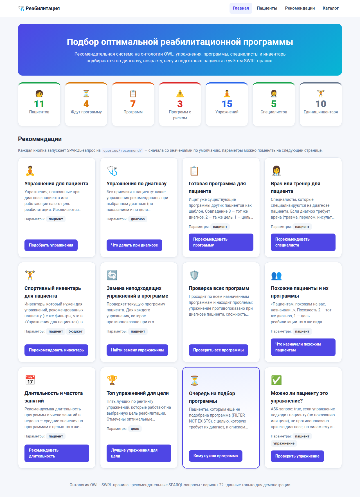
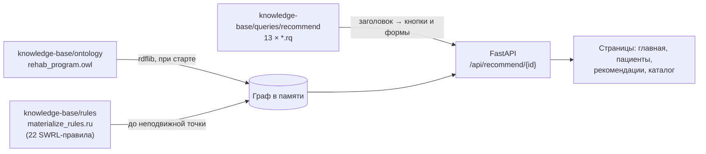
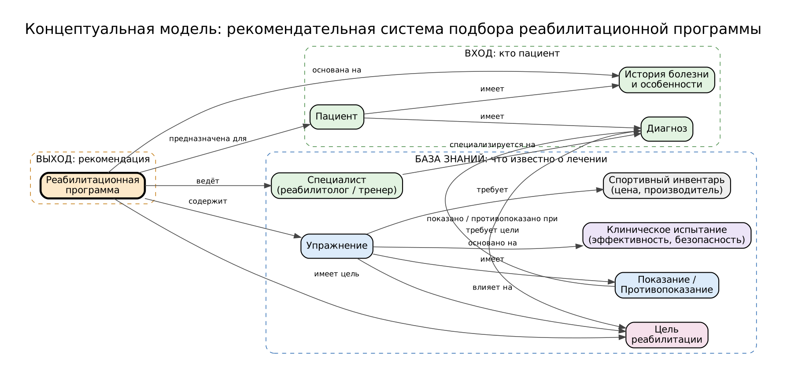
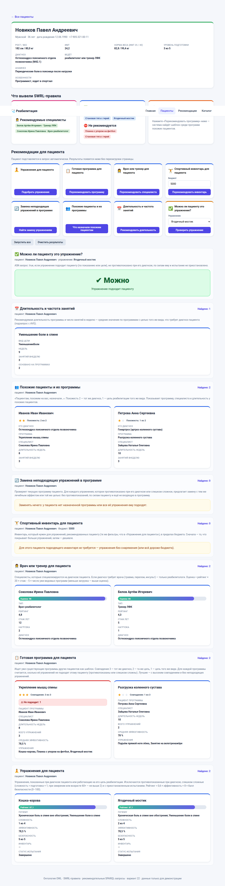
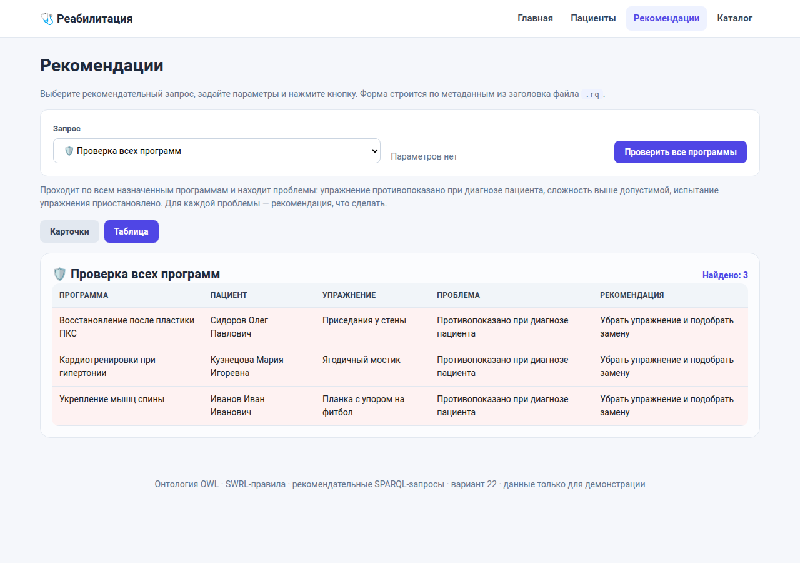
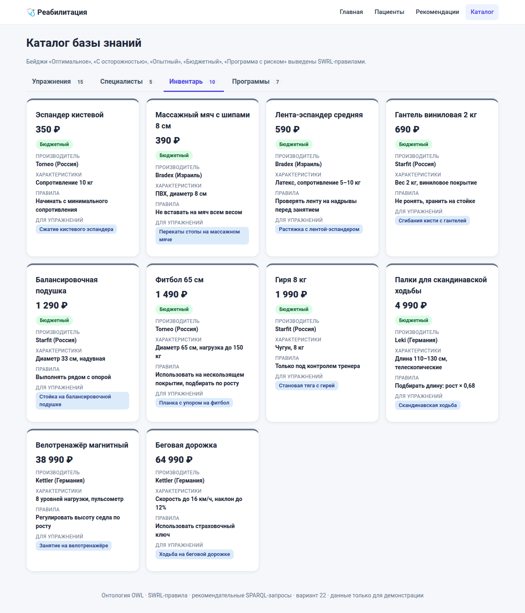

# Подбор оптимальной реабилитационной программы

Рекомендательная система на онтологии OWL (вариант 22). По данным пациента — диагнозу, возрасту, весу, росту
и уровню физической подготовки — она подбирает:

* **упражнения**, которые ему подходят, с объяснением «почему», и отсеивает опасные;
* **готовую программу**, взятую за основу: на сколько недель и сколько раз в неделю;
* **специалиста** — врача-реабилитолога или тренера ЛФК;
* **спортивный инвентарь** в пределах бюджета;
* **замену** опасному упражнению в уже назначенной программе.

Все знания хранятся в OWL-онтологии и SWRL-правилах, рекомендации считаются SPARQL-запросами.
Веб-приложение на FastAPI показывает всё это карточками и кнопками.



## Структура репозитория

```
Prolog-App/
├── knowledge-base/                 БАЗА ЗНАНИЙ — всё, что относится к онтологии
│   ├── ontology/                   rehab_program.owl (RDF/XML + 22 SWRL-правила), rehab_program.ttl (то же в Turtle)
│   ├── rules/                      materialize_rules.ru — SWRL-правила как SPARQL UPDATE (для rdflib)
│   │                               swrl_rules.txt, sqwrl_queries.txt — для Protégé
│   ├── queries/recommend/          13 рекомендательных SPARQL-запросов (*.rq) с метаданными в заголовке
│   ├── expected/                   эталонные результаты запросов и вывода правил (Pellet)
│   ├── docs/                       MODEL.md (классы, свойства, экземпляры), PROTEGE_GUIDE.md, диаграммы, исходное ТЗ
│   └── scripts/                    check_queries.py (проверка), build_ontology.py (генератор .owl), диаграммы
│
├── web-app/                        ВЕБ-ПРИЛОЖЕНИЕ — только код, знания берутся из ../knowledge-base
│   ├── app/                        FastAPI: main.py, ontology.py, sparql.py, config.py, templates/, static/
│   ├── tests/                      pytest: 115 тестов, сверка с knowledge-base/expected
│   ├── Dockerfile, docker-entrypoint.sh, docker-compose.yml
│   ├── requirements.txt
│   └── README.md                   подробно о приложении и API
│
└── README.md                       этот файл
```

База знаний и приложение разделены. Онтологию, правила и запросы можно открыть в Protégé и проверить
скриптом без веб-приложения. Приложение не хранит ни одного текста запроса: оно читает их из
`knowledge-base/queries/recommend/`.

**Важное уточнение по названию:** хотя репозиторий называется `Prolog-App`, текущая реализация не запускает
Prolog-движок. Факты хранятся в OWL, правила SWRL материализуются эквивалентными SPARQL UPDATE через RDFLib,
а рекомендации выполняются SPARQL-запросами. Если в критериях сдачи обязателен именно SWI-Prolog, это отдельное
требование, которое нельзя считать реализованным текущей архитектурой.

## Быстрый старт (Docker)

```bash
git clone git@github.com:Uscera-Liberty/Prolog-App.git
cd Prolog-App/web-app
docker compose up --build -d          # → http://127.0.0.1:8000
docker compose logs -f web            # логи (Ctrl+C — выйти из просмотра)
docker compose down                   # остановить и удалить контейнер
```

Другой порт задаётся так: `PORT=8080 docker compose up --build -d`. Из корня репозитория можно запустить то же самое
командой `docker compose -f web-app/docker-compose.yml up --build -d`.
Подробнее о запуске без Docker и о тестах — в [web-app/README.md](web-app/README.md).

## Как это работает



1. При старте приложение загружает `rehab_program.owl` в rdflib.
2. rdflib не исполняет SWRL, поэтому те же 22 правила записаны как SPARQL UPDATE в `rules/materialize_rules.ru`.
   Они применяются, пока граф растёт (2–3 прохода). Результат совпадает с выводом Pellet, это проверяет
   `scripts/check_queries.py`. Выводы живут только в памяти: файл `.owl` не изменяется.
3. Каждый файл `queries/recommend/NN_id.rq` начинается с заголовка, и приложение строит по нему кнопку, форму
   параметров и вид карточки результата:
   ```
   # id: exercises_for_patient
   # title: Упражнения для пациента
   # button: Подобрать упражнения
   # param: пациент | individual:Пациент | reh:Пациент_Новиков
   # card: title=упражнение; score=рейтинг; fields=почему,сложность,эффективность,…
   ```
   Значение по умолчанию уже стоит в тексте запроса, поэтому тот же файл без изменений работает в Protégé.
4. Параметры подставляются безопасно. Имя экземпляра проверяется регуляркой и наличием в онтологии экземпляра
   нужного класса, число проходит через `float()`. Сырая строка пользователя в SPARQL не попадает.

### Логика рекомендации упражнения

Логика одна и та же в правилах R06–R11 и в запросах 01, 05, 06, 12:

1. **Кандидат** — упражнение, *показанное при диагнозе* пациента **или** *влияющее на цель*, которую требует диагноз.
2. **Исключить**, если у упражнения есть противопоказание при этом диагнозе.
3. **Исключить**, если сложность > подготовка + 1. При ИМТ ≥ 30 или возрасте ≥ 60 исключить всё сложнее 2.
4. **Исключить**, если клиническое испытание упражнения приостановлено.
5. **Рейтинг** = 0,6 × эффективность (%) + 8 × балл безопасности (1–5), шкала 0–100.

## База знаний

| Что | Сколько |
|---|---|
| Классы | 44 (10 из них выводятся правилами) |
| Объектные свойства / свойства-данные | 46 / 29 |
| Экземпляры | 189: 11 пациентов (4 ждут программу), 8 диагнозов, 15 упражнений, 7 программ, 7 клинических испытаний, 5 специалистов, 10 единиц инвентаря |
| SWRL-правила | 22 |
| Рекомендательные SPARQL-запросы | 13 |



**Что выводят правила.** В приложении эти выводы показаны бейджами на карточках.

| Правила | Вывод |
|---|---|
| R01 | `имеетДиагноз`: цепочка пациент → данные → диагноз превращается в прямую связь |
| R02–R05 | Пороги веса для ИМТ 25 и 30, классы `ПациентСИзбыточнымВесом`, `ПациентСОжирением`, `ПожилойПациент` (возраст ≥ 60) |
| R06–R11 | `подходитУпражнение` (по показанию или цели) и `неРекомендуетсяУпражнение` (противопоказано, слишком сложно, ожирение или возраст + сложность > 2) |
| R12–R15 | `ЭффективноеУпражнение` (≥ 80 %), `БезопасноеУпражнение` (балл ≥ 4), `ОптимальноеУпражнение`, `УпражнениеСОсторожностью` (испытание приостановлено) |
| R16 | `ПрограммаСРиском`: в программе есть упражнение, не рекомендованное её пациенту |
| R17–R18 | `рекомендуемыйСпециалист`: реабилитолог по диагнозу; тренер — только если диагноз не требует врача |
| R19–R20 | `рекомендуемаяЦель`, `нуженИнвентарь` |
| R21–R22 | `БюджетныйИнвентарь` (≤ 5000 ₽), `ОпытныйСпециалист` (стаж ≥ 10 лет) |

Полное описание классов, свойств, экземпляров и правил — в
[knowledge-base/docs/MODEL.md](knowledge-base/docs/MODEL.md), диаграмма классов —
[knowledge-base/docs/diagrams/class_diagram.png](knowledge-base/docs/diagrams/class_diagram.png).

## 13 рекомендательных запросов

| № | id | Кнопка | Параметры | Что делает | Результат по умолчанию |
|---|---|---|---|---|---|
| 01 | `exercises_for_patient` | Подобрать упражнения | пациент | Подходящие упражнения с рейтингом и объяснением «почему» | Новиков: Кошка-корова, Ягодичный мостик (87,1) |
| 02 | `exercises_for_diagnosis` | Что делать при диагнозе | диагноз | Упражнения при диагнозе без привязки к пациенту | Плоскостопие: 3 упражнения |
| 03 | `program_for_patient` | Порекомендовать программу | пациент | Готовые программы других пациентов как шаблон: совпадение 3/2/1 и сколько упражнений не подходит | Новиков: «Укрепление мышц спины» (3, одно упражнение не подходит), «Разгрузка коленного сустава» (1) |
| 04 | `specialist_for_patient` | Порекомендовать специалиста | пациент | Врач или тренер по диагнозу; оценка = рейтинг × 20 + стаж − 5 × загрузка | Новиков: Соколова (98), Белов (86) |
| 05 | `equipment_for_patient` | Порекомендовать инвентарь | пациент, бюджет | Инвентарь для подходящих упражнений в пределах бюджета | Лебедева, 5000 ₽: массажный мяч 390 ₽, балансировочная подушка 1290 ₽ |
| 06 | `replace_exercise` | Найти замену упражнениям | пациент | Замена опасных упражнений в текущей программе (тот же эффект или та же цель) | Кузнецова: мостик → Кошка-корова, Приседания у стены, Подъём прямой ноги |
| 07 | `audit_programs` | Проверить все программы | — | Аудит всех программ: противопоказания, сложность, приостановленные испытания | 3 проблемы: Иванов, Кузнецова, Сидоров |
| 08 | `similar_patients` | Что назначали похожим пациентам | пациент | «Пациентам, похожим на вас, назначали…» | Фёдорова: Петрова (2), Иванов (1) |
| 09 | `schedule_for_patient` | Рекомендовать длительность | пациент | Средняя длительность и частота занятий по программам с целью того же вида | Лебедева: 14 недель, 3 раза в неделю |
| 10 | `top_exercises_for_goal` | Лучшие упражнения для цели | цель | Топ-5 по рейтингу с отметками «оптимальное» и «испытание приостановлено» | Боль в спине: 4 упражнения, гиря помечена |
| 11 | `waiting_list` | Кому нужна программа | — | Пациенты без программы, их цель и подходящие специалисты | Козлов, Лебедева, Новиков, Фёдорова |
| 12 | `can_patient_do` | Проверить упражнение | пациент, упражнение | ASK: можно ли пациенту это упражнение | Кузнецова + Ягодичный мостик → «Нельзя» |
| 13 | `contraindicated_for_patient` | Проверить ограничения | пациент | Причины, по которым упражнение не рекомендуется или противопоказано | Для пациента выводятся диагноз-специфичные противопоказания, ограничения по возрасту/ИМТ/сложности и остановленные испытания |

## Функционал веб-приложения

| Страница | Что умеет |
|---|---|
| `/` — главная | Счётчики (пациенты, ждут программу, программы с риском…) и 13 карточек-кнопок рекомендаций |
| `/patients` | Карточки пациентов: возраст, ИМТ, диагноз, программа и бейджи из правил («Ожирение», «Пожилой», «Программа с риском») |
| `/patients/{id}` | Профиль пациента, выводы правил (цель, специалисты, подходящие и запрещённые упражнения), текущая программа с пометкой опасных упражнений. Кнопки всех запросов с параметром «пациент», результат появляется карточками без перезагрузки |
| `/recommend` | Любой из 13 запросов. Форма параметров строится по заголовку `.rq`, вид результата — «Карточки» или «Таблица» |
| `/catalog` | Каталог базы знаний по вкладкам: упражнения, специалисты, инвентарь, программы — с бейджами правил |

JSON API (`/api/stats`, `/api/options/{класс}`, `/api/patients`, `/api/catalog/{раздел}`, `/api/queries`,
`POST /api/recommend/{id}`) описан в [web-app/README.md](web-app/README.md). Интерактивная документация
доступна на http://127.0.0.1:8000/docs.

| Страница пациента | Результат таблицей |
|---|---|
|  |   |

## Проверки

```bash
# база знаний: вывод правил против Pellet (18 сравнений) + 13 запросов
cd knowledge-base && pip install rdflib && python3 scripts/check_queries.py

# веб-приложение: API, рекомендации и сценарии пациентов
(cd web-app && pytest -q tests/test_api.py tests/test_user_data.py)
```


## Работа с собственными пациентами и назначение программ

1. На главной нажмите **«Подбор для себя»** или откройте `/patients/new`.
2. Укажите ФИО, пол, возраст, рост, вес, уровень подготовки и диагноз; анамнез, особенности образа жизни и телефон — дополнительные поля.
3. Сервер создаёт пациента в отдельном `user_data.json`, пересчитывает граф знаний и рекомендации. OWL-файл не переписывается.
4. В профиле пациента отображаются подходящие упражнения, причины ограничений, рекомендованные специалисты, инвентарь и форма назначения программы.
5. Назначенную программу можно заменить или удалить. Для упражнений, не рекомендуемых по уровню, возрасту или ИМТ, нужно отдельное подтверждение. Упражнения с противопоказанием к диагнозу и упражнения с приостановленным испытанием заблокированы и отклоняются сервером.

Новый пользовательский контент хранится в `REHAB_DATA_DIR/user_data.json` (по умолчанию `web-app/data/user_data.json`). При запуске через Docker Compose данные находятся в named volume `rehab-data`; том не удаляется обычным `docker compose down`, но удаляется командой `docker compose down -v`.

## Render

Для существующего Docker Web Service:

- **Root Directory** оставьте пустым (корень репозитория), иначе Docker не увидит `knowledge-base/`.
- **Dockerfile Path** задайте `web-app/Dockerfile`; **Docker Context** — корень репозитория (`.`).
- В Environment добавьте `REHAB_DATA_DIR=/var/data`.
- Для сохранения своих пациентов добавьте Persistent Disk с Mount Path `/var/data`. Без диска файловые данные могут исчезнуть при перезапуске/новом деплое. Free Web Services Render не поддерживают Persistent Disks; для постоянного хранения потребуется платный план/внешняя БД.
- После `git push` в подключённую ветку Render автоматически пересоберёт и задеплоит сервис, если включён Auto-Deploy. Либо запустите **Manual Deploy → Deploy latest commit**.

Вход и регистрация не предусмотрены: публичный адрес Render открывает доступ ко всем карточкам пациентов. Используйте только демонстрационные данные.

## Как расширять

* **Новый запрос.** Положите файл `knowledge-base/queries/recommend/13_my_query.rq` с таким же заголовком
  (`# id`, `# title`, `# button`, `# description`, `# param`, `# card`) и перезапустите приложение
  (`docker compose restart`). Запрос сам появится на главной, на странице «Рекомендации», а если у него есть
  параметр `пациент` — то и на странице пациента. Не используйте в `.rq` функции `YEAR()`, `NOW()`, `CONTAINS()`,
  `ROUND()`, `CONCAT()`, `LCASE()`: Protégé (Sesame 2.7) их не знает.
* **Новые данные.** Правьте `knowledge-base/scripts/build_ontology.py`, затем выполните
  `python3 scripts/build_ontology.py` (нужны rdflib и owlready2) и `python3 scripts/check_queries.py --write`,
  чтобы обновить эталоны.
* **Protégé.** Как открыть онтологию, запустить SWRL и SPARQL — в
  [knowledge-base/docs/PROTEGE_GUIDE.md](knowledge-base/docs/PROTEGE_GUIDE.md).
