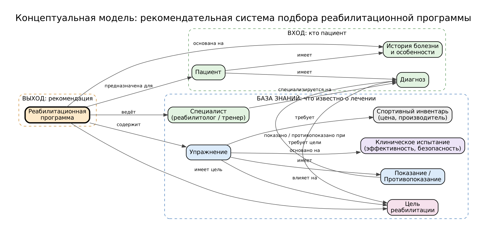
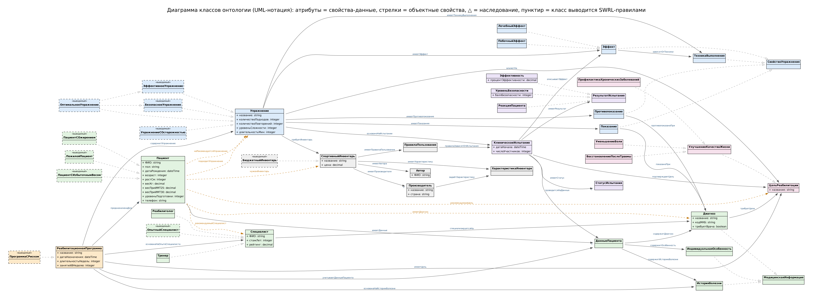
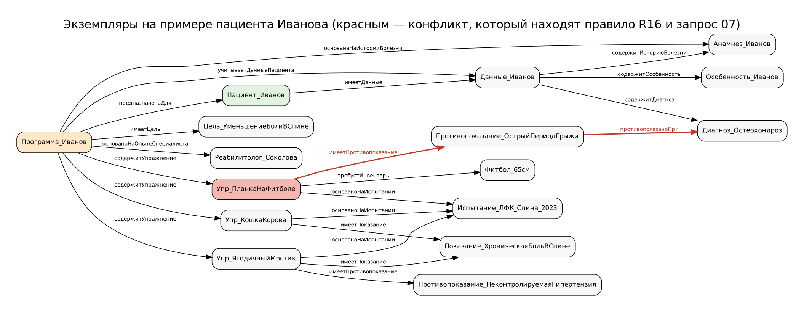

# Модель системы «Подбор оптимальной реабилитационной программы» (вариант 22)

## 1. Что это за система

**Рекомендательная система на онтологии (база знаний OWL).** На вход — пациент: диагноз, возраст, вес, рост, уровень подготовки.
На выходе — рекомендации:

* какие **упражнения** ему подходят (и почему), а какие нельзя;
* какую **готовую программу** взять за основу, на сколько недель и сколько раз в неделю;
* какого **специалиста** назначить (врача-реабилитолога или тренера ЛФК);
* какой **спортивный инвентарь** купить в пределах бюджета;
* что **заменить** в уже назначенной программе, если там есть опасное упражнение.

Знания лежат в трёх слоях:

| Слой | Где | Что делает |
|---|---|---|
| Онтология (классы, свойства, экземпляры) | `ontology/rehab_program.owl` | Факты: пациенты, диагнозы, упражнения, испытания, инвентарь, специалисты, программы |
| SWRL-правила (22 шт.) | вшиты в `.owl`, текст — `rules/swrl_rules.txt` | Выводят новые знания: «пациент с ожирением», «упражнение не рекомендуется пациенту», «программа с риском», «рекомендуемый специалист» |
| SPARQL-запросы (12 шт.) | `queries/recommend/*.rq` | Собственно рекомендации: подбор, ранжирование, фильтрация, проверка |

Логика рекомендации упражнения (одинакова в правилах R06–R11 и в запросах 01, 05, 06, 12):

1. **Кандидат:** упражнение *показано при диагнозе* пациента **или** *влияет на цель*, которую требует диагноз.
2. **Исключить**, если у упражнения есть противопоказание при этом диагнозе.
3. **Исключить**, если сложность > подготовка + 1; при ИМТ ≥ 30 или возрасте ≥ 60 — если сложность > 2.
4. **Исключить**, если клиническое испытание упражнения приостановлено.
5. **Рейтинг** = 0,6 × эффективность (%) + 8 × балл безопасности (1–5) → шкала 0–100.

## 2. Концептуальная модель

Пациент и его диагноз — **вход**. Упражнения, показания/противопоказания, цели, испытания, инвентарь и специалисты — **база знаний**.
Реабилитационная программа — **выход**, она связывает пациента, упражнения, цель и специалиста.

## 3. Диаграмма классов

(в `diagrams/class_diagram.svg` — векторная версия, её удобно увеличивать.)

## 4. Классы (44)

| Класс | Родитель | Источник | Смысл |
|---|---|---|---|
| `РеабилитационнаяПрограмма` | owl:Thing | со схемы | Подобранная для пациента программа реабилитации (центральное понятие). |
| `ПрограммаСРиском` | `РеабилитационнаяПрограмма` | выводится правилом | Программа, в которой есть упражнение, не рекомендованное её пациенту. |
| `Упражнение` | owl:Thing | со схемы | Отдельное упражнение, входящее в программу. |
| `ЭффективноеУпражнение` | `Упражнение` | выводится правилом | Эффективность по испытанию ≥ 80 %. |
| `БезопасноеУпражнение` | `Упражнение` | выводится правилом | Балл безопасности по испытанию ≥ 4 из 5. |
| `ОптимальноеУпражнение` | `Упражнение` | выводится правилом | Одновременно эффективное и безопасное. |
| `УпражнениеСОсторожностью` | `Упражнение` | выводится правилом | Испытание упражнения приостановлено — назначать с осторожностью. |
| `СвойствоУпражнения` | owl:Thing | добавлено | Группирующий класс для того, что описывает упражнение. |
| `Противопоказание` | `СвойствоУпражнения` | со схемы | Состояние, при котором упражнение выполнять нельзя. |
| `Показание` | `СвойствоУпражнения` | со схемы | Состояние, при котором упражнение рекомендовано. |
| `ТехникаВыполнения` | `СвойствоУпражнения` | со схемы | Правильная техника выполнения упражнения. |
| `Эффект` | `СвойствоУпражнения` | со схемы | Результат воздействия упражнения на организм. |
| `ЛечебныйЭффект` | `Эффект` | добавлено | Ожидаемый положительный эффект. |
| `ПобочныйЭффект` | `Эффект` | со схемы | Нежелательный эффект. |
| `Пациент` | owl:Thing | добавлено | Человек, для которого подбирается программа. |
| `ПациентСИзбыточнымВесом` | `Пациент` | выводится правилом | ИМТ от 25 до 30. |
| `ПациентСОжирением` | `Пациент` | выводится правилом | ИМТ ≥ 30 — ограничение сложности упражнений. |
| `ПожилойПациент` | `Пациент` | выводится правилом | Возраст ≥ 60 лет — ограничение сложности упражнений. |
| `ДанныеПациента` | owl:Thing | со схемы | Совокупность медицинских сведений о пациенте. |
| `МедицинскаяИнформация` | owl:Thing | добавлено | Группирующий класс для составных частей данных пациента. |
| `Диагноз` | `МедицинскаяИнформация` | со схемы | Установленный диагноз (код МКБ-10). |
| `ИсторияБолезни` | `МедицинскаяИнформация` | со схемы | Анамнез: перенесённые заболевания, травмы, операции. |
| `ИндивидуальнаяОсобенность` | `МедицинскаяИнформация` | со схемы | Образ жизни, ограничения и т.п. |
| `Специалист` | owl:Thing | со схемы | Тренер или реабилитолог, чей опыт используется при подборе программы. |
| `Тренер` | `Специалист` | со схемы | Тренер ЛФК. |
| `Реабилитолог` | `Специалист` | со схемы | Врач-реабилитолог. |
| `ОпытныйСпециалист` | `Специалист` | выводится правилом | Стаж ≥ 10 лет. |
| `ЦельРеабилитации` | owl:Thing | добавлено | Цель, на которую направлена программа. |
| `УлучшениеКачестваЖизни` | `ЦельРеабилитации` | со схемы | Общая цель программы. |
| `УменьшениеБоли` | `УлучшениеКачестваЖизни` | со схемы | Цели, связанные со снижением боли. |
| `ВосстановлениеПослеТравмы` | `УлучшениеКачестваЖизни` | со схемы | Реабилитация после травмы, операции, инсульта. |
| `ПрофилактикаХроническихЗаболеваний` | `УлучшениеКачестваЖизни` | со схемы | Профилактика прогрессирования и осложнений. |
| `КлиническоеИспытание` | owl:Thing | со схемы | Испытание, подтверждающее эффективность и безопасность упражнения. |
| `РезультатИспытания` | owl:Thing | добавлено | Группирующий класс для результатов испытаний. |
| `Эффективность` | `РезультатИспытания` | со схемы | Процент пациентов с улучшением. |
| `УровеньБезопасности` | `РезультатИспытания` | со схемы | Балл безопасности 1–5. |
| `РеакцияПациента` | `РезультатИспытания` | со схемы | Реакция пациентов на упражнение в ходе испытания. |
| `СтатусИспытания` | owl:Thing | со схемы | Статус испытания (перечисление). |
| `СпортивныйИнвентарь` | owl:Thing | со схемы | Инвентарь, необходимый для выполнения упражнения. |
| `БюджетныйИнвентарь` | `СпортивныйИнвентарь` | выводится правилом | Цена ≤ 5000 ₽. |
| `Производитель` | owl:Thing | со схемы | Производитель инвентаря. |
| `Автор` | owl:Thing | со схемы | Автор (разработчик) методики/инвентаря. |
| `ХарактеристикаИнвентаря` | owl:Thing | со схемы | Технические характеристики инвентаря. |
| `ПравилаПользования` | owl:Thing | со схемы | Правила безопасного пользования инвентарём. |

Непересекающиеся (disjoint): все классы верхнего уровня между собой; Противопоказание/Показание/Техника/Эффект; ЛечебныйЭффект/ПобочныйЭффект;
Диагноз/ИсторияБолезни/Особенность; Эффективность/Безопасность/Реакция; три вида целей; Тренер/Реабилитолог; избыточный вес/ожирение.

Ограничения: программа содержит ≥ 1 упражнение, имеет ≥ 1 цель, предназначена ровно 1 пациенту; упражнение имеет технику и лечебный эффект;
у пациента ровно 1 набор данных; у испытания ровно 1 статус; диагноз требует ≥ 1 цели. `СтатусИспытания` = {Планируется, Проводится, Завершено, Приостановлено}.

## 5. Объектные свойства — связи между классами (46)

| Свойство | Домен (откуда) | Диапазон (куда) | Подпись на рукописной схеме | Примечание |
|---|---|---|---|---|
| `содержитУпражнение` | РеабилитационнаяПрограмма | Упражнение | «содержит» | со схемы |
| `основанаНаОпытеСпециалиста` | РеабилитационнаяПрограмма | Специалист | «основана на» | со схемы |
| `основанаНаИсторииБолезни` | РеабилитационнаяПрограмма | ИсторияБолезни | «основана на» | со схемы |
| `имеетЦель` | РеабилитационнаяПрограмма | ЦельРеабилитации | «цель» | со схемы |
| `предназначенаДля` | РеабилитационнаяПрограмма | Пациент | — | добавлено · функц. |
| `учитываетДанныеПациента` | РеабилитационнаяПрограмма | ДанныеПациента | — | добавлено |
| `влияетНа` | Упражнение | ЦельРеабилитации | «влияет» | со схемы |
| `имеетПротивопоказание` | Упражнение | Противопоказание | «имеет» | со схемы |
| `имеетПоказание` | Упражнение | Показание | «имеет» | со схемы |
| `имеетТехникуВыполнения` | Упражнение | ТехникаВыполнения | «имеет» | со схемы |
| `имеетЭффект` | Упражнение | Эффект | «имеет» | со схемы |
| `имеетПобочныйЭффект` | Упражнение | ПобочныйЭффект | — | добавлено · подсвойство имеетЭффект |
| `требуетИнвентарь` | Упражнение | СпортивныйИнвентарь | «требуют» | со схемы |
| `основаноНаИспытании` | Упражнение | КлиническоеИспытание | «основаны на» | со схемы |
| `зависитОтТехники` | Эффект | ТехникаВыполнения | «зависит от» | со схемы |
| `противопоказаноПри` | Противопоказание | Диагноз | — | добавлено |
| `показаноПри` | Показание | Диагноз | — | добавлено |
| `требуетЦели` | Диагноз | ЦельРеабилитации | — | добавлено |
| `специализируетсяНа` | Специалист | Диагноз | — | добавлено |
| `имеетДанные` | Пациент | ДанныеПациента | — | добавлено · функц. |
| `содержитДиагноз` | ДанныеПациента | Диагноз | «содержат» | со схемы |
| `содержитИсториюБолезни` | ДанныеПациента | ИсторияБолезни | «содержат» | со схемы |
| `содержитОсобенность` | ДанныеПациента | ИндивидуальнаяОсобенность | «основаны на» | со схемы |
| `проводитсяНаДанных` | КлиническоеИспытание | ДанныеПациента | «основаны» | со схемы |
| `описываетЭффект` | КлиническоеИспытание | Эффект | «описывает» | со схемы |
| `имеетРезультат` | КлиническоеИспытание | РезультатИспытания | — | со схемы |
| `показываетЭффективность` | КлиническоеИспытание | Эффективность | — | со схемы · подсвойство имеетРезультат |
| `определяетУровеньБезопасности` | КлиническоеИспытание | УровеньБезопасности | — | со схемы · подсвойство имеетРезультат |
| `фиксируетРеакциюПациента` | КлиническоеИспытание | РеакцияПациента | — | со схемы · подсвойство имеетРезультат |
| `имеетСтатус` | КлиническоеИспытание | СтатусИспытания | — | со схемы · функц. |
| `подтверждаетЦель` | КлиническоеИспытание | ЦельРеабилитации | «зависит» | со схемы |
| `имеетПроизводителя` | СпортивныйИнвентарь | Производитель | — | со схемы · функц. |
| `имеетАвтора` | СпортивныйИнвентарь | Автор | — | со схемы |
| `имеетХарактеристику` | СпортивныйИнвентарь | ХарактеристикаИнвентаря | — | со схемы |
| `имеетПравилаПользования` | СпортивныйИнвентарь | ПравилаПользования | — | со схемы |
| `задаётХарактеристику` | Производитель | ХарактеристикаИнвентаря | — | со схемы |
| `правилаЗависятОтИспытания` | ПравилаПользования | КлиническоеИспытание | «зависит» | со схемы |
| `имеетДиагноз` | Пациент | Диагноз | — | выводится правилом |
| `подходитУпражнение` | Пациент | Упражнение | — | выводится правилом |
| `неРекомендуетсяУпражнение` | Пациент | Упражнение | — | выводится правилом |
| `рекомендуемыйСпециалист` | Пациент | Специалист | — | выводится правилом |
| `рекомендуемаяЦель` | Пациент | ЦельРеабилитации | — | выводится правилом |
| `нуженИнвентарь` | Пациент | СпортивныйИнвентарь | — | выводится правилом |
| `входитВПрограмму` | — | — | — | обратное к `содержитУпражнение` |
| `принадлежитПациенту` | — | — | — | обратное к `имеетДанные` |
| `требуетсяДляУпражнения` | — | — | — | обратное к `требуетИнвентарь` |

## 6. Свойства-данные (29)

| Свойство | У какого класса | Тип | Описание |
|---|---|---|---|
| `название` | любой | string | Название (программы, упражнения, диагноза, инвентаря). |
| `описание` | любой | string | Текстовое описание. |
| `ФИО` | любой | string | ФИО пациента, специалиста или автора. |
| `пол` | Пациент | string | «Мужской» / «Женский». |
| `датаРождения` | Пациент | dateTime |  |
| `возраст` | Пациент | integer | Полных лет на 01.10.2026. |
| `ростСм` | Пациент | integer |  |
| `весКг` | Пациент | decimal | Килограммы. |
| `весПриИМТ25` | Пациент | decimal | Вес (кг), при котором ИМТ = 25 для роста пациента. [выводится SWRL-правилом R02] |
| `весПриИМТ30` | Пациент | decimal | Вес (кг), при котором ИМТ = 30 для роста пациента. [выводится SWRL-правилом R02] |
| `уровеньПодготовки` | Пациент | integer | Физическая подготовка 1–5 (1 — минимальная). |
| `телефон` | Пациент | string |  |
| `кодМКБ` | Диагноз | string | Код МКБ-10. |
| `требуетВрача` | Диагноз | boolean | true — программу должен вести врач-реабилитолог, а не тренер. |
| `стажЛет` | Специалист | integer |  |
| `рейтинг` | Специалист | decimal | Оценка пациентов 1–5. |
| `датаНазначения` | РеабилитационнаяПрограмма | dateTime |  |
| `длительностьНедель` | РеабилитационнаяПрограмма | integer |  |
| `занятийВНеделю` | РеабилитационнаяПрограмма | integer |  |
| `количествоПодходов` | Упражнение | integer |  |
| `количествоПовторений` | Упражнение | integer |  |
| `уровеньСложности` | Упражнение | integer | 1 — очень лёгкое … 4 — сложное. |
| `длительностьМин` | Упражнение | integer |  |
| `процентЭффективности` | Эффективность | decimal |  |
| `баллБезопасности` | УровеньБезопасности | integer | 1–5. |
| `датаНачала` | КлиническоеИспытание | dateTime |  |
| `числоУчастников` | КлиническоеИспытание | integer |  |
| `цена` | СпортивныйИнвентарь | decimal | Рубли. |
| `страна` | Производитель | string |  |

## 7. Данные (экземпляры) — всего 189

### Пациенты
| ФИО | Возраст | Рост / вес | ИМТ | Подготовка | Диагноз (МКБ) | Программа |
|---|---|---|---|---|---|---|
| Иванов Иван Иванович | 47 | 178 / 86.0 | 27.1 | 2 | Остеохондроз поясничного отдела позвоночника (M42.1) | есть |
| Петрова Анна Сергеевна | 38 | 165 / 72.5 | 26.6 | 2 | Гонартроз (артроз коленного сустава) (M17.0) | есть |
| Сидоров Олег Павлович | 30 | 185 / 82.0 | 24.0 | 4 | Разрыв передней крестообразной связки (S83.5) | есть |
| Кузнецова Мария Игоревна | 64 | 160 / 78.0 | 30.5 | 1 | Гипертоническая болезнь (I10) | есть |
| Смирнов Алексей Викторович | 38 | 175 / 70.0 | 22.9 | 3 | Перелом лучевой кости (S52.5) | есть |
| Морозова Елена Дмитриевна | 55 | 168 / 61.0 | 21.6 | 2 | Идиопатический сколиоз (M41.1) | есть |
| Волков Дмитрий Андреевич | 69 | 172 / 90.0 | 30.4 | 1 | Последствия инсульта (I69.3) | есть |
| Лебедева Ольга Николаевна | 25 | 170 / 55.0 | 19.0 | 3 | Плоскостопие (M21.4) | **нет — ждёт подбора** |
| Новиков Павел Андреевич | 36 | 182 / 80.0 | 24.2 | 3 | Остеохондроз поясничного отдела позвоночника (M42.1) | **нет — ждёт подбора** |
| Фёдорова Галина Петровна | 69 | 158 / 84.0 | 33.6 | 1 | Гонартроз (артроз коленного сустава) (M17.0) | **нет — ждёт подбора** |
| Козлов Андрей Викторович | 60 | 176 / 98.0 | 31.6 | 2 | Гипертоническая болезнь (I10) | **нет — ждёт подбора** |

### Диагнозы
| Диагноз | МКБ | Требует врача | Цель реабилитации |
|---|---|---|---|
| Остеохондроз поясничного отдела позвоночника | M42.1 | нет | УменьшениеБолиВСпине |
| Гонартроз (артроз коленного сустава) | M17.0 | нет | УменьшениеБолиВКолене |
| Разрыв передней крестообразной связки | S83.5 | да | ВосстановлениеКолена |
| Гипертоническая болезнь | I10 | нет | ПрофилактикаОсложненийГипертонии |
| Перелом лучевой кости | S52.5 | да | ВосстановлениеКисти |
| Идиопатический сколиоз | M41.1 | нет | ПрофилактикаПрогрессированияСколиоза |
| Последствия инсульта | I69.3 | да | ВосстановлениеПослеИнсульта |
| Плоскостопие | M21.4 | нет | УкреплениеСводаСтопы |

### Специалисты
| ФИО | Тип | Стаж | Рейтинг | Специализация (диагнозы) |
|---|---|---|---|---|
| Соколова Ирина Павловна | Реабилитолог | 12 | 4.8 | Остеохондроз, Сколиоз, ПереломЛучевой |
| Орлов Виктор Семёнович | Реабилитолог | 20 | 4.9 | РазрывСвязки, ПоследствияИнсульта, ПереломЛучевой |
| Белов Артём Игоревич | Тренер | 5 | 4.3 | Гипертония, Остеохондроз |
| Зайцева Наталья Олеговна | Тренер | 8 | 4.7 | АртрозКолена, Сколиоз, Плоскостопие |
| Ким Сергей Алексеевич | Тренер | 6 | 4.6 | Плоскостопие, Гипертония, АртрозКолена |

### Упражнения
| Упражнение | Сложность | Инвентарь | Эффективность / безопасность | Противопоказание | Цель |
|---|---|---|---|---|---|
| Кошка-корова | 1 | — | 78.5 % / 5 | — | УменьшениеБолиВСпине |
| Планка с упором на фитбол | 3 | Фитбол_65см | 78.5 % / 5 | ОстрыйПериодГрыжи | УменьшениеБолиВСпине |
| Ягодичный мостик | 2 | — | 78.5 % / 5 | НеконтролируемаяГипертензия | УменьшениеБолиВСпине |
| Приседания у стены | 2 | — | 84.0 % / 4 | НестабильностьКолена | ВосстановлениеКолена |
| Подъём прямой ноги лёжа | 1 | — | 84.0 % / 4 | — | УменьшениеБолиВКолене |
| Сгибания кисти с гантелей | 1 | Гантель_2кг | 91.0 % / 5 | — | ВосстановлениеКисти |
| Сжатие кистевого эспандера | 1 | Эспандер_Кистевой | 91.0 % / 5 | — | ВосстановлениеКисти |
| Ходьба на беговой дорожке | 2 | Беговая_Дорожка | 72.0 % / 4 | НарушениеРавновесия | ПрофилактикаОсложненийГипертонии |
| Занятие на велотренажёре | 2 | Велотренажёр | 72.0 % / 4 | — | ПрофилактикаОсложненийГипертонии |
| Скандинавская ходьба | 2 | Палки_Скандинавские | 72.0 % / 4 | — | ПрофилактикаПрогрессированияСколиоза |
| Растяжка с лентой-эспандером | 1 | Лента_Эспандер | 69.5 % / 3 | — | ВосстановлениеПослеИнсульта |
| Становая тяга с гирей | 4 | Гиря_8кг | 65.0 % / 2 | ОстрыйПериодГрыжи | УменьшениеБолиВСпине |
| Перекаты стопы на массажном мяче | 1 | Мяч_Массажный | 82.0 % / 5 | — | УкреплениеСводаСтопы |
| Захват мелких предметов пальцами ног | 1 | — | 82.0 % / 5 | — | УкреплениеСводаСтопы |
| Стойка на балансировочной подушке | 3 | Балансировочная_Подушка | 82.0 % / 5 | НарушениеРавновесия | УкреплениеСводаСтопы |

### Программы
| Программа | Пациент | Специалист | Цель | Длительность | Упражнения |
|---|---|---|---|---|---|
| Укрепление мышц спины | Иванов | Соколова | УменьшениеБолиВСпине | 8 нед × 3/нед | КошкаКорова, ПланкаНаФитболе, ЯгодичныйМостик |
| Разгрузка коленного сустава | Петрова | Зайцева | УменьшениеБолиВКолене | 10 нед × 3/нед | ПодъёмПрямойНоги, Велотренажёр |
| Восстановление после пластики ПКС | Сидоров | Орлов | ВосстановлениеКолена | 12 нед × 5/нед | ПодъёмПрямойНоги, ПриседанияУСтены, Велотренажёр, ЯгодичныйМостик |
| Кардиотренировки при гипертонии | Кузнецова | Белов | ПрофилактикаОсложненийГипертонии | 12 нед × 3/нед | ХодьбаНаДорожке, Велотренажёр, ЯгодичныйМостик |
| Разработка кисти после перелома | Смирнов | Соколова | ВосстановлениеКисти | 6 нед × 5/нед | СгибанияКистиСГантелей, СжатиеЭспандера |
| Коррекция осанки при сколиозе | Морозова | Зайцева | ПрофилактикаПрогрессированияСколиоза | 16 нед × 3/нед | КошкаКорова, СкандинавскаяХодьба, РастяжкаСЛентой, ПланкаНаФитболе |
| Восстановление после инсульта | Волков | Орлов | ВосстановлениеПослеИнсульта | 24 нед × 4/нед | РастяжкаСЛентой, СжатиеЭспандера |

> Намеренные ошибки для демонстрации: в программах Иванова, Кузнецовой и Сидорова есть противопоказанное упражнение —
> их находят правило R16 и запросы 06/07.

### Инвентарь
| Инвентарь | Цена | Производитель |
|---|---|---|
| Фитбол 65 см | 1490 ₽ | Torneo |
| Гантель виниловая 2 кг | 690 ₽ | Starfit |
| Эспандер кистевой | 350 ₽ | Torneo |
| Лента-эспандер средняя | 590 ₽ | Bradex |
| Беговая дорожка | 64990 ₽ | Kettler |
| Велотренажёр магнитный | 38990 ₽ | Kettler |
| Палки для скандинавской ходьбы | 4990 ₽ | Leki |
| Гиря 8 кг | 1990 ₽ | Starfit |
| Массажный мяч с шипами 8 см | 390 ₽ | Bradex |
| Балансировочная подушка | 1290 ₽ | Starfit |

### Все экземпляры по классам
| Класс | Кол-во | Экземпляры |
|---|---|---|
| `РеабилитационнаяПрограмма` | 7 | Программа_Волков, Программа_Иванов, Программа_Кузнецова, Программа_Морозова, Программа_Петрова, Программа_Сидоров, Программа_Смирнов |
| `Упражнение` | 15 | Упр_Велотренажёр, Упр_ЗахватПальцамиНог, Упр_КошкаКорова, Упр_ПерекатыСтопыМячом, Упр_ПланкаНаФитболе, Упр_ПодъёмПрямойНоги, Упр_ПриседанияУСтены, Упр_РастяжкаСЛентой, Упр_СгибанияКистиСГантелей, Упр_СжатиеЭспандера, Упр_СкандинавскаяХодьба, Упр_СтановаяТягаСГирей, Упр_СтойкаНаПодушке, Упр_ХодьбаНаДорожке, Упр_ЯгодичныйМостик |
| `Противопоказание` | 4 | Противопоказание_НарушениеРавновесия, Противопоказание_НеконтролируемаяГипертензия, Противопоказание_НестабильностьКолена, Противопоказание_ОстрыйПериодГрыжи |
| `Показание` | 6 | Показание_ГиподинамияИЛишнийВес, Показание_ОграничениеПодвижностиКисти, Показание_СкованностьМышц, Показание_СлабостьМышцБедра, Показание_СлабостьМышцСтопы, Показание_ХроническаяБольВСпине |
| `ТехникаВыполнения` | 15 | Техника_Велотренажёр, Техника_ЗахватПальцамиНог, Техника_КошкаКорова, Техника_ПерекатыСтопыМячом, Техника_ПланкаНаФитболе, Техника_ПодъёмПрямойНоги, Техника_ПриседанияУСтены, Техника_РастяжкаСЛентой, Техника_СгибанияКистиСГантелей, Техника_СжатиеЭспандера, Техника_СкандинавскаяХодьба, Техника_СтановаяТягаСГирей, Техника_СтойкаНаПодушке, Техника_ХодьбаНаДорожке, Техника_ЯгодичныйМостик |
| `ЛечебныйЭффект` | 6 | Эффект_Выносливость, Эффект_ГибкостьПозвоночника, Эффект_МелкаяМоторика, Эффект_УкреплениеКора, Эффект_УкреплениеМышцБедра, Эффект_УкреплениеСводаСтопы |
| `ПобочныйЭффект` | 3 | ПобЭффект_БольВКолене, ПобЭффект_БольВПояснице, ПобЭффект_ПовышениеДавления |
| `Пациент` | 11 | Пациент_Волков, Пациент_Иванов, Пациент_Козлов, Пациент_Кузнецова, Пациент_Лебедева, Пациент_Морозова, Пациент_Новиков, Пациент_Петрова, Пациент_Сидоров, Пациент_Смирнов, Пациент_Фёдорова |
| `ДанныеПациента` | 11 | Данные_Волков, Данные_Иванов, Данные_Козлов, Данные_Кузнецова, Данные_Лебедева, Данные_Морозова, Данные_Новиков, Данные_Петрова, Данные_Сидоров, Данные_Смирнов, Данные_Фёдорова |
| `Диагноз` | 8 | Диагноз_АртрозКолена, Диагноз_Гипертония, Диагноз_Остеохондроз, Диагноз_ПереломЛучевой, Диагноз_Плоскостопие, Диагноз_ПоследствияИнсульта, Диагноз_РазрывСвязки, Диагноз_Сколиоз |
| `ИсторияБолезни` | 11 | Анамнез_Волков, Анамнез_Иванов, Анамнез_Козлов, Анамнез_Кузнецова, Анамнез_Лебедева, Анамнез_Морозова, Анамнез_Новиков, Анамнез_Петрова, Анамнез_Сидоров, Анамнез_Смирнов, Анамнез_Фёдорова |
| `ИндивидуальнаяОсобенность` | 11 | Особенность_Волков, Особенность_Иванов, Особенность_Козлов, Особенность_Кузнецова, Особенность_Лебедева, Особенность_Морозова, Особенность_Новиков, Особенность_Петрова, Особенность_Сидоров, Особенность_Смирнов, Особенность_Фёдорова |
| `Тренер` | 3 | Тренер_Белов, Тренер_Зайцева, Тренер_Ким |
| `Реабилитолог` | 2 | Реабилитолог_Орлов, Реабилитолог_Соколова |
| `УменьшениеБоли` | 2 | Цель_УменьшениеБолиВКолене, Цель_УменьшениеБолиВСпине |
| `ВосстановлениеПослеТравмы` | 3 | Цель_ВосстановлениеКисти, Цель_ВосстановлениеКолена, Цель_ВосстановлениеПослеИнсульта |
| `ПрофилактикаХроническихЗаболеваний` | 3 | Цель_ПрофилактикаОсложненийГипертонии, Цель_ПрофилактикаПрогрессированияСколиоза, Цель_УкреплениеСводаСтопы |
| `КлиническоеИспытание` | 7 | Испытание_Гиря_2025, Испытание_Инсульт_2026, Испытание_Кардио_2024, Испытание_Кисть_2024, Испытание_Колено_2023, Испытание_ЛФК_Спина_2023, Испытание_Стопа_2025 |
| `Эффективность` | 7 | Эффективность_Испытание_Гиря_2025, Эффективность_Испытание_Инсульт_2026, Эффективность_Испытание_Кардио_2024, Эффективность_Испытание_Кисть_2024, Эффективность_Испытание_Колено_2023, Эффективность_Испытание_ЛФК_Спина_2023, Эффективность_Испытание_Стопа_2025 |
| `УровеньБезопасности` | 7 | Безопасность_Испытание_Гиря_2025, Безопасность_Испытание_Инсульт_2026, Безопасность_Испытание_Кардио_2024, Безопасность_Испытание_Кисть_2024, Безопасность_Испытание_Колено_2023, Безопасность_Испытание_ЛФК_Спина_2023, Безопасность_Испытание_Стопа_2025 |
| `РеакцияПациента` | 7 | Реакция_Испытание_Гиря_2025, Реакция_Испытание_Инсульт_2026, Реакция_Испытание_Кардио_2024, Реакция_Испытание_Кисть_2024, Реакция_Испытание_Колено_2023, Реакция_Испытание_ЛФК_Спина_2023, Реакция_Испытание_Стопа_2025 |
| `СтатусИспытания` | 4 | Статус_Завершено, Статус_Планируется, Статус_Приостановлено, Статус_Проводится |
| `СпортивныйИнвентарь` | 10 | Балансировочная_Подушка, Беговая_Дорожка, Велотренажёр, Гантель_2кг, Гиря_8кг, Лента_Эспандер, Мяч_Массажный, Палки_Скандинавские, Фитбол_65см, Эспандер_Кистевой |
| `Производитель` | 5 | Производитель_Bradex, Производитель_Kettler, Производитель_Leki, Производитель_Starfit, Производитель_Torneo |
| `Автор` | 1 | Автор_Бубновский |
| `ХарактеристикаИнвентаря` | 10 | Характеристика_Балансировочная_Подушка, Характеристика_Беговая_Дорожка, Характеристика_Велотренажёр, Характеристика_Гантель_2кг, Характеристика_Гиря_8кг, Характеристика_Лента_Эспандер, Характеристика_Мяч_Массажный, Характеристика_Палки_Скандинавские, Характеристика_Фитбол_65см, Характеристика_Эспандер_Кистевой |
| `ПравилаПользования` | 10 | Правила_Балансировочная_Подушка, Правила_Беговая_Дорожка, Правила_Велотренажёр, Правила_Гантель_2кг, Правила_Гиря_8кг, Правила_Лента_Эспандер, Правила_Мяч_Массажный, Правила_Палки_Скандинавские, Правила_Фитбол_65см, Правила_Эспандер_Кистевой |

Пример связей экземпляров (пациент Иванов):

## 8. SWRL-правила (22)

| Правило | Что выводит | Текст |
|---|---|---|
| R01_ДиагнозПациента | Цепочка Пациент → ДанныеПациента → Диагноз сокращается до прямой связи имеетДиагноз. | `Пациент(?p) ^ имеетДанные(?p, ?d) ^ содержитДиагноз(?d, ?dg) -> имеетДиагноз(?p, ?dg)` |
| R02_ПорогиВеса | ИМТ = вес / (рост/100)², значит ИМТ = 25 при весе 0,0025·рост², ИМТ = 30 при весе 0,003·рост². Деления нет намеренно: swrlb:divide в SWRLTab (Drools) падает на бесконечных дробях. | `Пациент(?p) ^ ростСм(?p, ?h) ^ multiply(?h2, ?h, ?h) ^ multiply(?a, ?h2, 0.0025) ^ multiply(?b, ?h2, 0.003) -> весПриИМТ25(?p, ?a) ^ весПриИМТ30(?p, ?b)` |
| R03_Ожирение | ИМТ ≥ 30, то есть вес ≥ весПриИМТ30. | `Пациент(?p) ^ весКг(?p, ?w) ^ весПриИМТ30(?p, ?b) ^ greaterThanOrEqual(?w, ?b) -> ПациентСОжирением(?p)` |
| R04_ИзбыточныйВес | 25 ≤ ИМТ < 30. | `Пациент(?p) ^ весКг(?p, ?w) ^ весПриИМТ25(?p, ?a) ^ весПриИМТ30(?p, ?b) ^ greaterThanOrEqual(?w, ?a) ^ lessThan(?w, ?b) -> ПациентСИзбыточнымВесом(?p)` |
| R05_ПожилойПациент | Возраст ≥ 60 лет. | `Пациент(?p) ^ возраст(?p, ?a) ^ greaterThanOrEqual(?a, 60) -> ПожилойПациент(?p)` |
| R06_ПодходитПоПоказанию | Упражнение показано при диагнозе пациента. | `имеетДиагноз(?p, ?dg) ^ показаноПри(?s, ?dg) ^ имеетПоказание(?u, ?s) -> подходитУпражнение(?p, ?u)` |
| R07_ПодходитПоЦели | Упражнение влияет на цель, которую требует диагноз пациента. | `имеетДиагноз(?p, ?dg) ^ требуетЦели(?dg, ?g) ^ влияетНа(?u, ?g) -> подходитУпражнение(?p, ?u)` |
| R08_Противопоказано | У упражнения есть противопоказание при диагнозе пациента. | `имеетДиагноз(?p, ?dg) ^ имеетПротивопоказание(?u, ?c) ^ противопоказаноПри(?c, ?dg) -> неРекомендуетсяУпражнение(?p, ?u)` |
| R09_СлишкомСложно | Сложность упражнения больше уровня подготовки пациента + 1. | `Пациент(?p) ^ уровеньПодготовки(?p, ?l) ^ Упражнение(?u) ^ уровеньСложности(?u, ?s) ^ add(?max, ?l, 1) ^ greaterThan(?s, ?max) -> неРекомендуетсяУпражнение(?p, ?u)` |
| R10_ОжирениеИСложность | При ожирении — только упражнения сложности ≤ 2. | `ПациентСОжирением(?p) ^ Упражнение(?u) ^ уровеньСложности(?u, ?s) ^ greaterThan(?s, 2) -> неРекомендуетсяУпражнение(?p, ?u)` |
| R11_ВозрастИСложность | Пожилым — только упражнения сложности ≤ 2. | `ПожилойПациент(?p) ^ Упражнение(?u) ^ уровеньСложности(?u, ?s) ^ greaterThan(?s, 2) -> неРекомендуетсяУпражнение(?p, ?u)` |
| R12_ЭффективноеУпражнение | Эффективность по испытанию ≥ 80 %. | `основаноНаИспытании(?u, ?t) ^ показываетЭффективность(?t, ?e) ^ процентЭффективности(?e, ?v) ^ greaterThanOrEqual(?v, 80) -> ЭффективноеУпражнение(?u)` |
| R13_БезопасноеУпражнение | Балл безопасности по испытанию ≥ 4. | `основаноНаИспытании(?u, ?t) ^ определяетУровеньБезопасности(?t, ?b) ^ баллБезопасности(?b, ?v) ^ greaterThanOrEqual(?v, 4) -> БезопасноеУпражнение(?u)` |
| R14_ОптимальноеУпражнение | Эффективное и безопасное одновременно. | `ЭффективноеУпражнение(?u) ^ БезопасноеУпражнение(?u) -> ОптимальноеУпражнение(?u)` |
| R15_СОсторожностью | Испытание упражнения приостановлено. | `основаноНаИспытании(?u, ?t) ^ имеетСтатус(?t, Статус_Приостановлено) -> УпражнениеСОсторожностью(?u)` |
| R16_ПрограммаСРиском | В программе есть упражнение, не рекомендованное её пациенту. | `предназначенаДля(?pr, ?p) ^ содержитУпражнение(?pr, ?u) ^ неРекомендуетсяУпражнение(?p, ?u) -> ПрограммаСРиском(?pr)` |
| R17_СпециалистВрач | Реабилитолог, специализирующийся на диагнозе пациента. | `имеетДиагноз(?p, ?dg) ^ Реабилитолог(?s) ^ специализируетсяНа(?s, ?dg) -> рекомендуемыйСпециалист(?p, ?s)` |
| R18_СпециалистТренер | Тренер — только если диагноз не требует врача. | `имеетДиагноз(?p, ?dg) ^ требуетВрача(?dg, false) ^ Тренер(?s) ^ специализируетсяНа(?s, ?dg) -> рекомендуемыйСпециалист(?p, ?s)` |
| R19_ЦельПациента | Цель реабилитации следует из диагноза. | `имеетДиагноз(?p, ?dg) ^ требуетЦели(?dg, ?g) -> рекомендуемаяЦель(?p, ?g)` |
| R20_НуженИнвентарь | Инвентарь для подходящих пациенту упражнений. | `подходитУпражнение(?p, ?u) ^ требуетИнвентарь(?u, ?i) -> нуженИнвентарь(?p, ?i)` |
| R21_БюджетныйИнвентарь | Цена ≤ 5000 ₽. | `СпортивныйИнвентарь(?i) ^ цена(?i, ?c) ^ lessThanOrEqual(?c, 5000) -> БюджетныйИнвентарь(?i)` |
| R22_ОпытныйСпециалист | Стаж ≥ 10 лет. | `Специалист(?s) ^ стажЛет(?s, ?y) ^ greaterThanOrEqual(?y, 10) -> ОпытныйСпециалист(?s)` |

Проверено: Pellet (owlready2) и Drools (SWRLTab в Protégé 5.5) дают одинаковый результат; SPARQL-копии правил
(`rules/materialize_rules.ru`) — тоже (сверка в `scripts/check_queries.py`).
SQWRL-запросы по выведенным фактам — `rules/sqwrl_queries.txt` (8 шт., проверены в SQWRLTab).

## 9. Рекомендательные SPARQL-запросы (12)

| № | Название | Параметры | Что делает |
|---|---|---|---|
| 01 | Упражнения для пациента | пациент | Упражнения, показанные при диагнозе пациента или работающие на его цель реабилитации. Исключаются противопоказанные при диагнозе, слишком сложные (сложность > подготовка + 1; при ожирении или возрасте 60+ — не выше 2) и с приостановленным испытанием. Рейтинг = 0,6 × эффективность + 8 × балл безопасности (0–100). |
| 02 | Упражнения по диагнозу | диагноз | Без привязки к пациенту: какие упражнения рекомендованы при выбранном диагнозе (по показаниям и по цели реабилитации), без противопоказанных и без приостановленных испытаний. Сортировка по рейтингу. |
| 03 | Готовая программа для пациента | пациент | Ищет уже существующие программы других пациентов как шаблон. Совпадение 3 — тот же диагноз, 2 — та же цель, 1 — цель того же вида. Для каждой программы считается, сколько её упражнений не подходят этому пациенту (противопоказаны или слишком сложны). Лучшие — с высоким совпадением и без неподходящих упражнений. |
| 04 | Врач или тренер для пациента | пациент | Специалисты, которые специализируются на диагнозе пациента. Если диагноз требует врача (травма, перелом, инсульт) — только реабилитологи. Оценка = рейтинг × 20 + стаж − 5 × число уже ведомых программ (меньше загрузка — выше оценка). |
| 05 | Спортивный инвентарь для пациента | пациент, бюджет | Инвентарь, который нужен для упражнений, рекомендованных пациенту (те же фильтры, что в «Упражнения для пациента»), в пределах бюджета. Сначала — то, что покрывает больше упражнений, затем — дешевле. |
| 06 | Замена неподходящих упражнений в программе | пациент | Проверяет текущую программу пациента. Для каждого упражнения, которое противопоказано при его диагнозе или слишком сложное, предлагает замену с тем же лечебным эффектом или той же целью: без противопоказаний, по силам пациенту и ещё не входящую в программу. |
| 07 | Проверка всех программ | — | Проходит по всем назначенным программам и находит проблемы: упражнение противопоказано при диагнозе пациента, сложность выше допустимой, испытание упражнения приостановлено. Для каждой проблемы — рекомендация, что сделать. |
| 08 | Похожие пациенты и их программы | пациент | «Пациентам, похожим на вас, назначали…». Похожесть 2 — тот же диагноз, 1 — цель реабилитации того же вида. Показывает программу, специалиста и длительность у похожих пациентов. |
| 09 | Длительность и частота занятий | пациент | Рекомендуемая длительность программы и число занятий в неделю — средние значения по программам с целью того же вида, что требует диагноз пациента (подзапрос с AVG). |
| 10 | Топ упражнений для цели | цель | Пять лучших по рейтингу упражнений, которые работают на выбранную цель реабилитации. Отмечены оптимальные (эффективность ≥ 80 % и безопасность ≥ 4) и упражнения с приостановленным испытанием. |
| 11 | Очередь на подбор программы | — | Пациенты, которым ещё не подобрана программа (FILTER NOT EXISTS), с целью, которую требует их диагноз, и списком подходящих специалистов (с учётом «требует врача»). |
| 12 | Можно ли пациенту это упражнение? | пациент, упражнение | ASK-запрос: true, если упражнение подходит пациенту (по показанию или цели), не противопоказано при его диагнозе, по силам ему и испытание не приостановлено. |

Ожидаемые результаты при параметрах по умолчанию — `expected/expected_results.json`. Например:
* 01 (Новиков): Кошка-корова, Ягодичный мостик — планка и становая тяга отсеяны как противопоказанные при остеохондрозе;
* 04 (Новиков): Соколова Ирина Павловна (98.0), Белов Артём Игоревич (86.0);
* 06 (Кузнецова): ягодичный мостик противопоказан → замены: Кошка-корова, Приседания у стены, Подъём прямой ноги лёжа;
* 11: без программы — Козлов Андрей Викторович, Лебедева Ольга Николаевна, Новиков Павел Андреевич, Фёдорова Галина Петровна.
