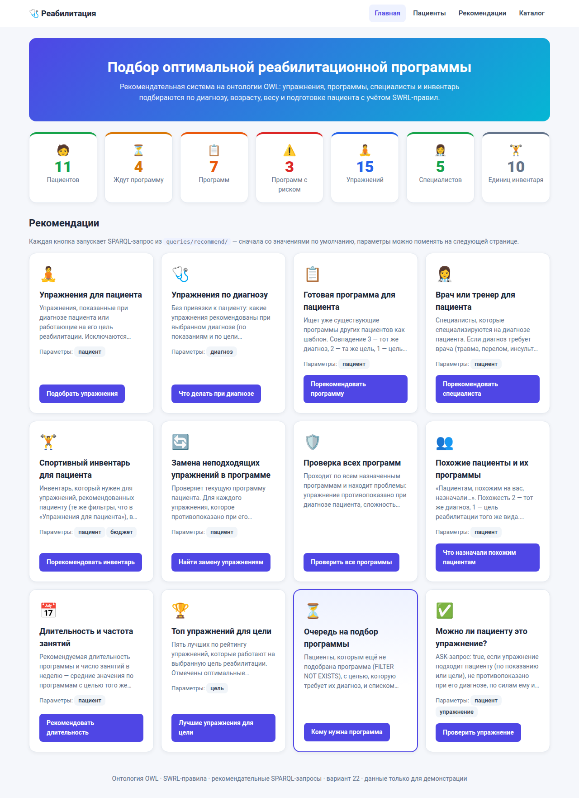
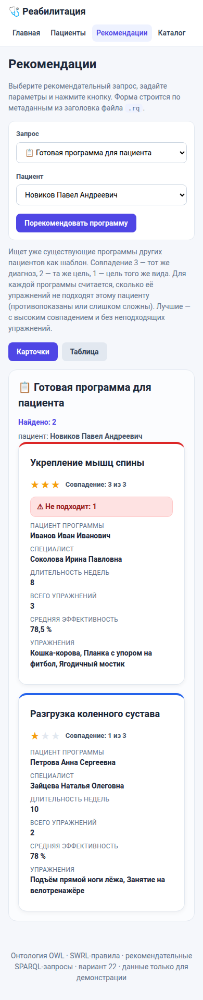

# web-app — веб-приложение «Подбор реабилитационной программы»

FastAPI + Jinja2. Приложение не хранит знаний само: при старте оно читает каталог базы знаний
[`../knowledge-base`](../knowledge-base) — онтологию, правила и запросы.

* `ontology/rehab_program.owl` загружается в rdflib;
* правила `rules/materialize_rules.ru` применяются до неподвижной точки, выводы живут только в памяти;
* запросы `queries/recommend/*.rq` по своим заголовкам становятся кнопками, формами и карточками.

## Запуск в Docker (рекомендуется)

Все команды выполняются из папки `web-app/`:

```bash
docker compose up --build -d          # собрать образ и запустить → http://127.0.0.1:8000
docker compose ps                     # статус (healthy — приложение отвечает)
docker compose logs -f web            # логи
docker compose restart                # перечитать базу знаний после правки .rq / .owl
docker compose down                   # остановить и удалить контейнер
```

* Порт: `PORT=8080 docker compose up --build -d`.
* Тесты внутри контейнера: `docker compose run --rm web pytest -q -p no:cacheprovider`.
* Контекст сборки — корень репозитория (`context: ..`), потому что в образ копируются и `web-app/`, и
  `knowledge-base/`. Собрать образ без compose можно из корня репозитория:
  `docker build -f web-app/Dockerfile -t rehab-web-app .`
* `../knowledge-base` подключён в контейнер томом **только на чтение** (`/srv/knowledge-base`). Поэтому правка
  запросов не требует пересборки образа — достаточно `docker compose restart`.
* Образ построен на `python:3.12-slim` и весит около 180 МБ. Приложение работает от непривилегированного
  пользователя, в образе настроен HEALTHCHECK по `/api/stats`.

## Запуск без Docker

Нужен Python 3.10+. Команды выполняются из папки `web-app/`:

```bash
python3 -m venv .venv && source .venv/bin/activate
pip install -r requirements.txt
uvicorn app.main:app --reload         # http://127.0.0.1:8000
pytest -q tests/test_api.py          # API и эталоны SPARQL
pytest -q tests/test_user_data.py    # пациенты, программы, правила
```

Каталог базы знаний приложение ищет в таком порядке ([app/config.py](app/config.py)):

1. переменная окружения `REHAB_KB_DIR`, например `REHAB_KB_DIR=/path/to/knowledge-base uvicorn app.main:app`;
2. текущая папка приложения, если в ней есть `ontology/` (старая раскладка «всё в одной папке»);
3. соседний каталог `../knowledge-base` — раскладка этого репозитория.

Если онтология не найдена, приложение при старте сообщит, по какому пути искало.

## Работа с пользовательскими пациентами

`/patients/new` позволяет добавить себя или другого демонстрационного пациента: ФИО, пол, возраст, рост,
вес, подготовка, диагноз, анамнез, особенности образа жизни и телефон. Данные сохраняются отдельно от OWL
в `REHAB_DATA_DIR/user_data.json`; после каждого изменения граф пересобирается и SWRL-правила/ SPARQL-рекомендации
пересчитываются. В профиле отображаются ограничения, подходящие специалисты, упражнения и инвентарь.

Назначение программ проверяется на сервере: специалист должен входить в список, рекомендованный для диагноза;
прямое противопоказание и приостановленное клиническое испытание блокируют упражнение; упражнение, помеченное
как неподходящее по возрасту, ИМТ или уровню подготовки, требует отдельного явного подтверждения.

## Страницы

| Адрес | Что там |
|---|---|
| `/` | Счётчики и 13 карточек-кнопок рекомендаций. Кнопка открывает `/recommend?q=<id>&run=1` |
| `/patients` | Карточки пациентов с бейджами из SWRL-выводов: «Ожирение», «Избыточный вес», «Пожилой», «Программа с риском» |
| `/patients/Пациент_Новиков` | Профиль, выводы правил, текущая программа и кнопки всех запросов с параметром «пациент» (01, 03, 04, 05, 06, 08, 09, 12). Пациент подставляется сам, результаты появляются ниже карточками без перезагрузки. Кнопка «Запустить все» запускает все запросы сразу |
| `/recommend?q=<id>&run=1` | Любой запрос: форма строится по заголовку `.rq` (`select` для экземпляров, числовое поле для чисел). Результат показывается карточками или таблицей |
| `/catalog?tab=exercises\|specialists\|equipment\|programs` | Каталог базы знаний с бейджами «Оптимальное», «С осторожностью», «Опытный», «Бюджетный», «Программа с риском» |
| `/docs` | Swagger UI — интерактивная документация API |

Как рисуется карточка результата, задаёт поле `card` в заголовке запроса:

* `title` — заголовок;
* `score` — полоса 0–100 или звёзды «3 из 3» для совпадения и похожести;
* `warn` — красная плашка, если значение не пустое и не 0;
* `tag` — бейдж;
* `fields` — список «подпись: значение».

Ответ ASK-запроса выводится большой плашкой «Можно» или «Нельзя».

## Хранение и Render

Пользовательские пациенты и программы хранятся в `REHAB_DATA_DIR/user_data.json`, отдельно от OWL. В Docker Compose
для этого подключён именованный том `rehab-data`; обычный `docker compose down` его сохраняет.

Входа и регистрации нет. Render публикует приложение по общедоступному адресу, поэтому используйте там только
демонстрационные данные.

Для существующего Render Docker Web Service оставьте Root Directory пустым, задайте Dockerfile Path
`web-app/Dockerfile` и контекст сборки корень репозитория. Для сохранения `user_data.json` подключите Persistent Disk
с Mount Path `/var/data` и задайте `REHAB_DATA_DIR=/var/data`. Бесплатные Web Services не поддерживают Persistent
Disks, поэтому локальные файловые данные на них не сохраняются при перезапусках и деплоях.

## JSON API

| Метод | Путь | Ответ |
|---|---|---|
| GET | `/api/stats` | `{пациенты, безПрограммы, программы, программыСРиском, упражнения, специалисты, инвентарь}` |
| GET | `/api/options/{класс}` | `[{id, label}]` — экземпляры класса с учётом подклассов (Пациент, Диагноз, ЦельРеабилитации, Упражнение…) |
| GET | `/api/patients` | Карточки пациентов: ФИО, возраст, ИМТ, диагноз, программа, бейджи |
| GET | `/api/patients/{id}` | Профиль, выводы правил, программа с упражнениями (`bad: true` — не рекомендовано пациенту) |
| GET | `/api/catalog/{exercises\|specialists\|equipment\|programs}` | Справочники |
| GET | `/api/queries` | Метаданные всех запросов: id, title, button, description, params (+ варианты), card |
| GET | `/api/patients/{id}/program-form` | Упражнения, специалист и шаблоны, предлагаемые для назначения |
| POST | `/api/patients/{id}/program` | Проверка и назначение программы |
| DELETE | `/api/patients/{id}/program` | Удаление назначенной пользовательской программы |
| POST | `/api/recommend/{id}` | Тело `{"params": {…}}` (можно без тела — тогда берутся значения по умолчанию). Ответ: `{columns, rows, iri_columns}` или `{answer}` |

Коды ошибок: **404** — неизвестный запрос, пациент или класс; **422** — недопустимый параметр, сообщение по-русски
в поле `detail`.

```bash
curl -X POST http://127.0.0.1:8000/api/recommend/exercises_for_patient \
     -H 'Content-Type: application/json' \
     -d '{"params": {"пациент": "Пациент_Новиков"}}'

curl -X POST http://127.0.0.1:8000/api/recommend/equipment_for_patient \
     -H 'Content-Type: application/json' \
     -d '{"params": {"пациент": "Пациент_Лебедева", "бюджет": 5000}}'

curl -X POST http://127.0.0.1:8000/api/recommend/can_patient_do \
     -H 'Content-Type: application/json' \
     -d '{"params": {"пациент": "Пациент_Кузнецова", "упражнение": "Упр_ЯгодичныйМостик"}}'
# → {"answer": false}
```

`iri_columns` — служебные колонки с идентификаторами экземпляров (`у`, `пр`, `пац`…). На карточках они
не показываются: из них строятся ссылки на пациента или на элемент каталога.

## Устройство

```
app/
  config.py        где лежит база знаний (REHAB_KB_DIR / ./ontology / ../knowledge-base)
  sparql.py        реестр queries/recommend/*.rq: разбор заголовка, проверка и подстановка параметров, запуск
                   (функции перенесены из knowledge-base/scripts/check_queries.py)
  ontology.py      загрузка графа + правила, справочники для страниц, бейджи, статистика
  main.py          FastAPI: маршруты страниц и API, обработка ошибок
  templates/       base.html, index.html, patients.html, patient.html, recommend.html, catalog.html, _cards.html, error.html
  static/          style.css (адаптивные карточки), app.js (запуск запросов и отрисовка карточек)
tests/test_api.py  pytest
Dockerfile, docker-entrypoint.sh, docker-compose.yml, requirements.txt, pytest.ini
```

**Безопасность параметров.** Имя экземпляра проверяется регуляркой `^[0-9A-Za-zА-Яа-яЁё_]+$`, затем проверяется,
что экземпляр нужного класса существует в онтологии. Число проходит через `float()` и проверку на конечность.
Сырая строка пользователя в SPARQL не попадает.

**Тесты** (`tests/test_api.py`, `tests/test_user_data.py`) проверяют:

* все 13 запросов с параметрами по умолчанию против `knowledge-base/expected/expected_results.json`
  (порядок значений внутри `GROUP_CONCAT` не учитывается);
* ответы 422 на попытки инъекции и на несуществующий экземпляр, 404 на неизвестный запрос;
* статистику (11 пациентов, 4 без программы, 7 программ, 3 с риском);
* что все HTML-страницы открываются.



